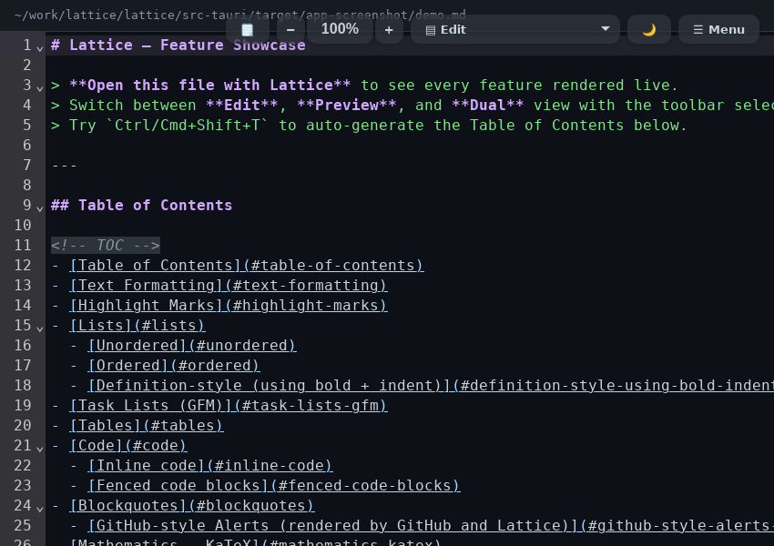
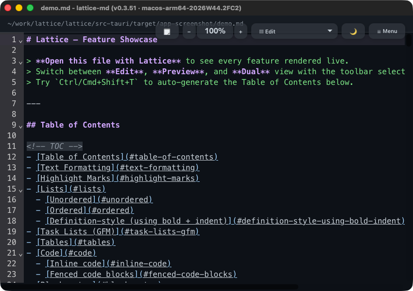
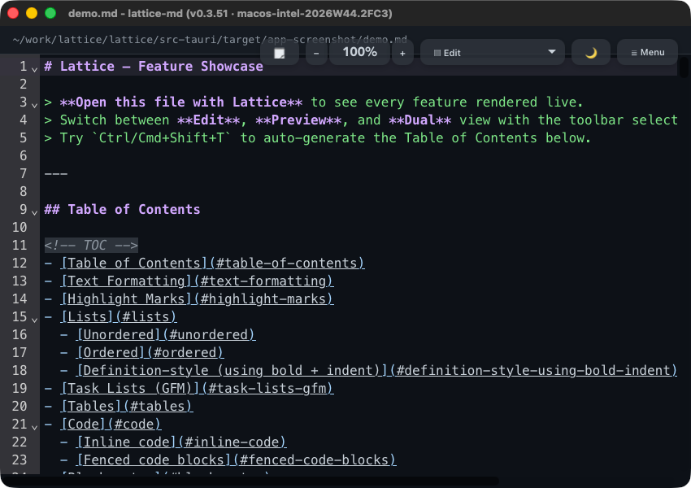
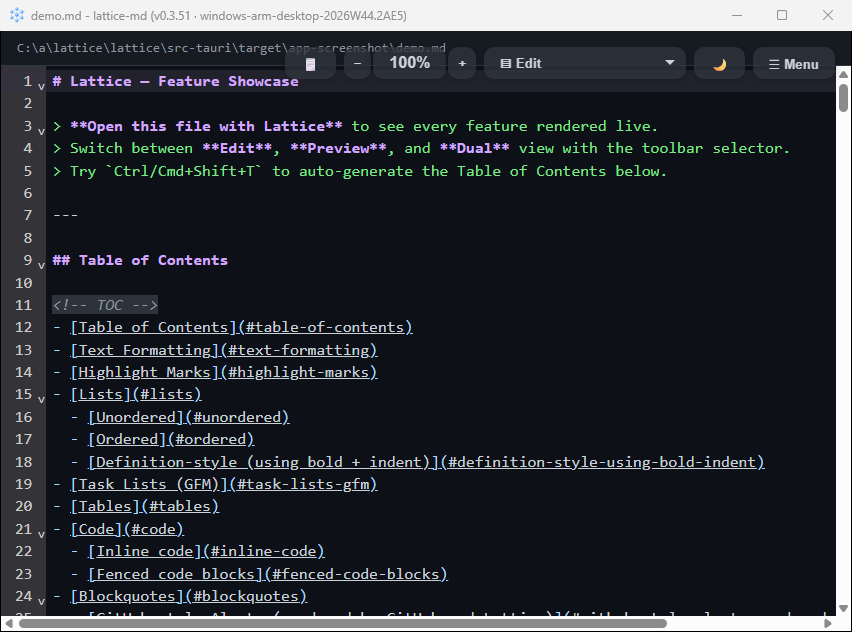
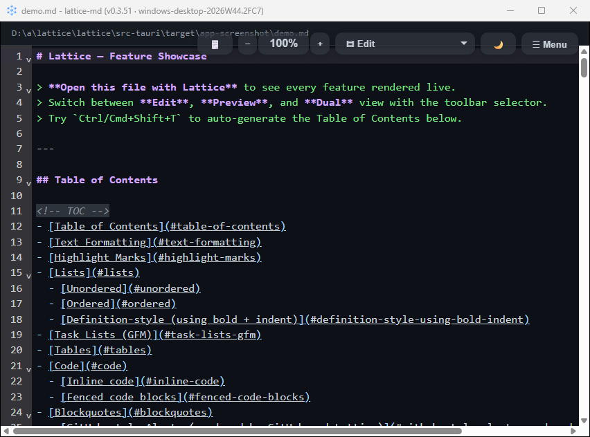
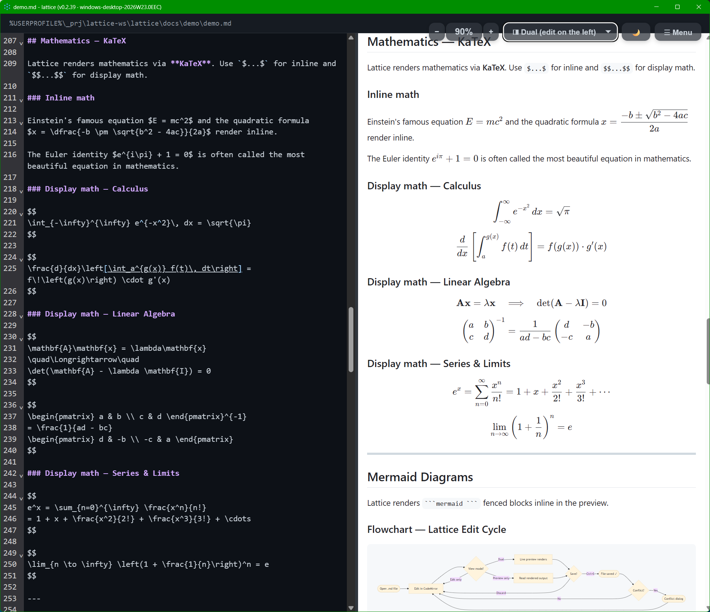
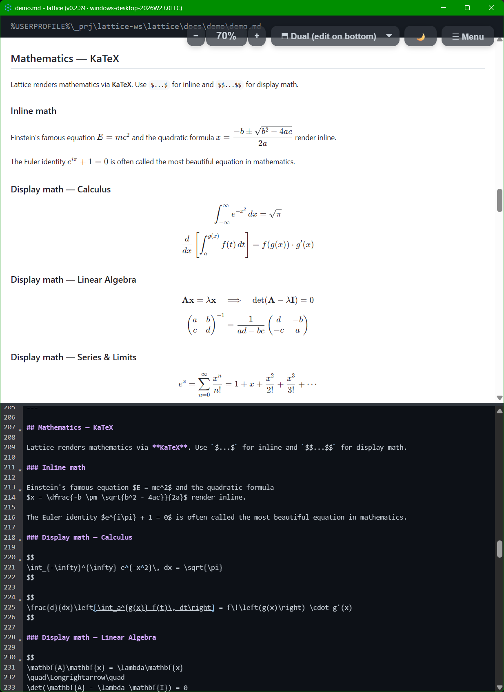
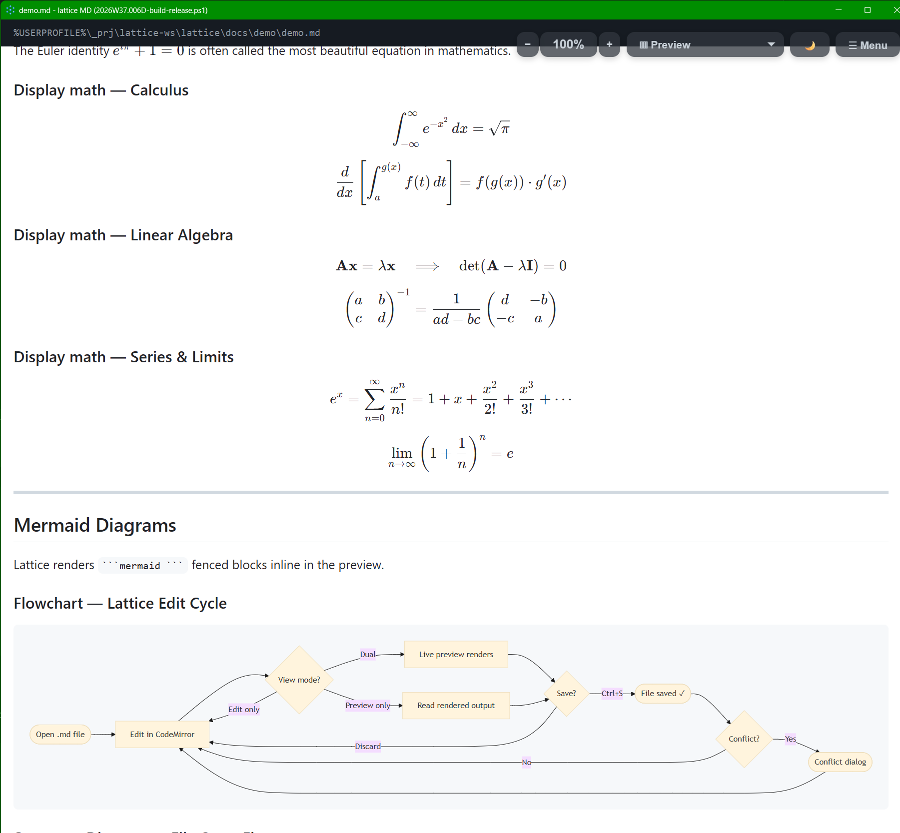
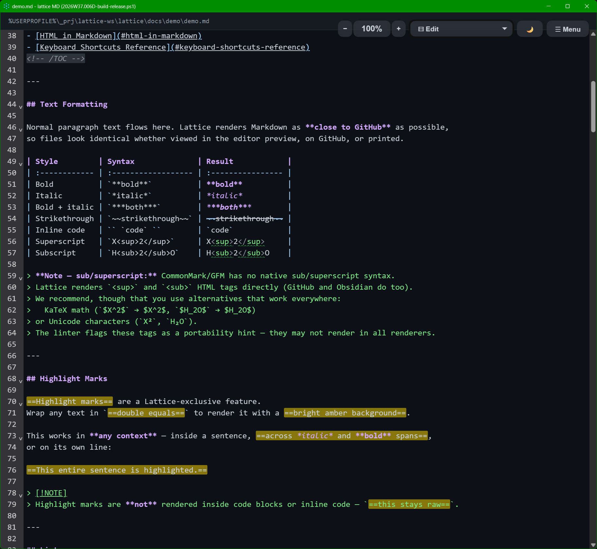

# Lattice v0.3.51
**Released:** 2026-10-28 20:27 UTC
### Changes
- FIX: Notice additions - review cycle 2 nits: own heading for blocked additions, sorted export ids
- FIX: Notice additions - review cycle 1: block a release on unused ones, tighter paths and quotes
- FEAT: Carry the notices the Legattice ledger adds - code inside packages under its own licence
- FIX: FIX FOSS compliance tooling scripts, tests, and documentation for false positives
- FEAT: add FOSS compliance workflow, test documentation, and system requirements specification
- CHORE: update dev dependencies and their licence notes
## Download Lattice

**Windows users: install from the Microsoft Store**

<a href="https://get.microsoft.com/installer/download/9pm3gb09941t?referrer=appbadge" target="_self"><picture>   <source media="(prefers-color-scheme: dark)" srcset="https://get.microsoft.com/images/en-us%20light.svg">   </picture></a>

<p>With a browser, just jump to:<br><a href="https://apps.microsoft.com/detail/9pm3gb09941t">https://apps.microsoft.com/detail/9pm3gb09941t</a></p>

Or download a package directly:

| File | Install on | Size |
|:-----|:-----------|-----:|
| [app-universal-release-unsigned.apk](https://github.com/blessia-blessini/lattice/releases/download/v0.3.51/app-universal-release-unsigned.apk) | <span class="material-icons">android</span> Android — Universal | 65.9 MB |
| [app-universal-release.aab](https://github.com/blessia-blessini/lattice/releases/download/v0.3.51/app-universal-release.aab) | <span class="material-icons">android</span> Android — Universal (Play Store) | 29.4 MB |
| [lattice-android.cdx.json](https://github.com/blessia-blessini/lattice/releases/download/v0.3.51/lattice-android.cdx.json) | <span class="material-icons">inventory_2</span> SBOM (CycloneDX) — android | 0.4 MB |
| [lattice-linux-arm64-appimage.cdx.json](https://github.com/blessia-blessini/lattice/releases/download/v0.3.51/lattice-linux-arm64-appimage.cdx.json) | <span class="material-icons">inventory_2</span> SBOM (CycloneDX) — linux-arm64-appimage | 0.1 MB |
| [lattice-linux-arm64.cdx.json](https://github.com/blessia-blessini/lattice/releases/download/v0.3.51/lattice-linux-arm64.cdx.json) | <span class="material-icons">inventory_2</span> SBOM (CycloneDX) — linux-arm64 | 0.4 MB |
| [lattice-linux-x64-appimage.cdx.json](https://github.com/blessia-blessini/lattice/releases/download/v0.3.51/lattice-linux-x64-appimage.cdx.json) | <span class="material-icons">inventory_2</span> SBOM (CycloneDX) — linux-x64-appimage | 0.1 MB |
| [lattice-linux-x64.cdx.json](https://github.com/blessia-blessini/lattice/releases/download/v0.3.51/lattice-linux-x64.cdx.json) | <span class="material-icons">inventory_2</span> SBOM (CycloneDX) — linux-x64 | 0.4 MB |
| [lattice-macos-arm64.cdx.json](https://github.com/blessia-blessini/lattice/releases/download/v0.3.51/lattice-macos-arm64.cdx.json) | <span class="material-icons">inventory_2</span> SBOM (CycloneDX) — macos-arm64 | 0.4 MB |
| [lattice-macos-x64.cdx.json](https://github.com/blessia-blessini/lattice/releases/download/v0.3.51/lattice-macos-x64.cdx.json) | <span class="material-icons">inventory_2</span> SBOM (CycloneDX) — macos-x64 | 0.4 MB |
| [lattice-md.msixbundle](https://github.com/blessia-blessini/lattice/releases/download/v0.3.51/lattice-md.msixbundle) | <span class="material-icons">window</span> Windows — Store bundle (.msixbundle, sideload) | 13.5 MB |
| [lattice-win-arm64.cdx.json](https://github.com/blessia-blessini/lattice/releases/download/v0.3.51/lattice-win-arm64.cdx.json) | <span class="material-icons">inventory_2</span> SBOM (CycloneDX) — win-arm64 | 0.4 MB |
| [lattice-win-x64.cdx.json](https://github.com/blessia-blessini/lattice/releases/download/v0.3.51/lattice-win-x64.cdx.json) | <span class="material-icons">inventory_2</span> SBOM (CycloneDX) — win-x64 | 0.4 MB |
| [lattice_0.3.51_aarch64.AppImage](https://github.com/blessia-blessini/lattice/releases/download/v0.3.51/lattice_0.3.51_aarch64.AppImage) | <span class="material-icons">terminal</span> Linux — ARM64 (AppImage) | 80.1 MB |
| [lattice_0.3.51_aarch64.dmg](https://github.com/blessia-blessini/lattice/releases/download/v0.3.51/lattice_0.3.51_aarch64.dmg) | <span class="material-icons">laptop_mac</span> macOS — Apple Silicon (ARM64) | 7.5 MB |
| [lattice_0.3.51_amd64.AppImage](https://github.com/blessia-blessini/lattice/releases/download/v0.3.51/lattice_0.3.51_amd64.AppImage) | <span class="material-icons">terminal</span> Linux — x86-64 (AppImage) | 82.0 MB |
| [lattice_0.3.51_amd64.deb](https://github.com/blessia-blessini/lattice/releases/download/v0.3.51/lattice_0.3.51_amd64.deb) | <span class="material-icons">terminal</span> Linux — x86-64 (Debian / Ubuntu) | 8.4 MB |
| [lattice_0.3.51_arm64-setup.exe](https://lattice-md.app/Lattice-Releases/assets-v0.3.51/bin-hex/lattice_0.3.51_arm64-setup.exe) | <span class="material-icons">window</span> Windows — ARM64 | 5.3 MB |
| [lattice_0.3.51_arm64.deb](https://github.com/blessia-blessini/lattice/releases/download/v0.3.51/lattice_0.3.51_arm64.deb) | <span class="material-icons">terminal</span> Linux — ARM64 (Debian / Ubuntu) | 8.4 MB |
| [lattice_0.3.51_x64-setup.exe](https://lattice-md.app/Lattice-Releases/assets-v0.3.51/bin-hex/lattice_0.3.51_x64-setup.exe) | <span class="material-icons">window</span> Windows — Intel / AMD (x86-64) | 5.6 MB |
| [lattice_0.3.51_x64.dmg](https://github.com/blessia-blessini/lattice/releases/download/v0.3.51/lattice_0.3.51_x64.dmg) | <span class="material-icons">laptop_mac</span> macOS — Intel (x86-64) | 7.6 MB |
| [SHA256SUMS.txt](https://lattice-md.app/Lattice-Releases/assets-v0.3.51/bin-hex/SHA256SUMS.txt) | <span class="material-icons">tag</span> Checksums (SHA-256) | 0.0 MB |
| [THIRD-PARTY-NOTICES.md](https://github.com/blessia-blessini/lattice/releases/download/v0.3.51/THIRD-PARTY-NOTICES.md) | <span class="material-icons">gavel</span> Third-party licences and copyrights | 0.9 MB |

## Notes

- [Full release on GitHub](https://github.com/blessia-blessini/lattice/releases/tag/v0.3.51)
- DUAL LICENSE — for terms, see [README.md section Licensing](https://github.com/blessia-blessini/lattice#licensing).
- Third-party components and their licences: [THIRD-PARTY-NOTICES.md](https://github.com/blessia-blessini/lattice/releases/download/v0.3.51/THIRD-PARTY-NOTICES.md).
- Lattice collects no personal data — see the [Privacy Statement](https://github.com/blessia-blessini/lattice/blob/dev/PRIVACY.md).

## Test Coverage

- [BACKEND](https://lattice-md.app/Lattice-Releases/assets-v0.3.51/coverage/src-tauri/target/llvm-cov/html/)
- [FRONTEND](https://lattice-md.app/Lattice-Releases/assets-v0.3.51/coverage/coverage/)

## Demo Document
A Markdown file — open directly in Lattice, read on GitHub, or view as HTML/PDF here.

### A document named `demo.md`


- Only for reference, as [rendered by GitHub](https://github.com/blessia-blessini/lattice-docs-releases/blob/main/Lattice-Releases/assets-v0.3.51/docs/demo/demo.md)
- The plaintext that you would actually edit: [Raw .md](https://raw.githubusercontent.com/blessia-blessini/lattice-docs-releases/main/Lattice-Releases/assets-v0.3.51/docs/demo/demo.md)

### Lattice on each desktop

Each desktop build in this release started the app it built, opened `demo.md`
and took one screenshot of its main window — what you get on that platform.

#### <span class="material-icons">terminal</span> Linux — ARM64


#### <span class="material-icons">terminal</span> Linux — x86-64



#### <span class="material-icons">laptop_mac</span> macOS — Apple Silicon (ARM64)



#### <span class="material-icons">laptop_mac</span> macOS — Intel (x86-64)



#### <span class="material-icons">window</span> Windows — ARM64



#### <span class="material-icons">window</span> Windows — Intel / AMD (x86-64)



### Generated by Lattice itself

Each desktop build in this release exported `demo.md` on its own operating
system, through that platform's own WebView. Nothing below was produced by
hand or by a converter — it is the output of the same `--export-html` and
`--export-pdf` commands you can run yourself:

```sh
lattice --export-html demo.md
lattice --export-pdf demo.md                 # A4
lattice --export-pdf --paper a3 demo.md      # or: --paper letter
```

#### <span class="material-icons">terminal</span> Linux — ARM64

<iframe src="pdf-viewer.html?file=https%3A%2F%2Fraw.githubusercontent.com%2Fblessia-blessini%2Flattice-docs-releases%2Fmain%2FLattice-Releases%2Fassets-v0.3.51%2Fdocs%2Fdemo%2Fgenerated%2Fdemo-linux-arm-desktop.pdf" width="100%" style="border:none;border-radius:4px;margin:12px 0;display:block;min-height:70vh"></iframe>

- Download [Lattice-generated PDF, A4](https://raw.githubusercontent.com/blessia-blessini/lattice-docs-releases/main/Lattice-Releases/assets-v0.3.51/docs/demo/generated/demo-linux-arm-desktop.pdf)
- Download [Lattice-generated PDF, A3](https://raw.githubusercontent.com/blessia-blessini/lattice-docs-releases/main/Lattice-Releases/assets-v0.3.51/docs/demo/generated/demo-linux-arm-desktop.a3.pdf)
- Download [Lattice-generated PDF, US Letter](https://raw.githubusercontent.com/blessia-blessini/lattice-docs-releases/main/Lattice-Releases/assets-v0.3.51/docs/demo/generated/demo-linux-arm-desktop.letter.pdf)
- Open the [Lattice-generated HTML](assets-v0.3.51/docs/demo/generated/demo-linux-arm-desktop.html)

#### <span class="material-icons">terminal</span> Linux — x86-64

<iframe src="pdf-viewer.html?file=https%3A%2F%2Fraw.githubusercontent.com%2Fblessia-blessini%2Flattice-docs-releases%2Fmain%2FLattice-Releases%2Fassets-v0.3.51%2Fdocs%2Fdemo%2Fgenerated%2Fdemo-linux-desktop.pdf" width="100%" style="border:none;border-radius:4px;margin:12px 0;display:block;min-height:70vh"></iframe>

- Download [Lattice-generated PDF, A4](https://raw.githubusercontent.com/blessia-blessini/lattice-docs-releases/main/Lattice-Releases/assets-v0.3.51/docs/demo/generated/demo-linux-desktop.pdf)
- Download [Lattice-generated PDF, A3](https://raw.githubusercontent.com/blessia-blessini/lattice-docs-releases/main/Lattice-Releases/assets-v0.3.51/docs/demo/generated/demo-linux-desktop.a3.pdf)
- Download [Lattice-generated PDF, US Letter](https://raw.githubusercontent.com/blessia-blessini/lattice-docs-releases/main/Lattice-Releases/assets-v0.3.51/docs/demo/generated/demo-linux-desktop.letter.pdf)
- Open the [Lattice-generated HTML](assets-v0.3.51/docs/demo/generated/demo-linux-desktop.html)

#### <span class="material-icons">laptop_mac</span> macOS — Apple Silicon (ARM64)

<iframe src="pdf-viewer.html?file=https%3A%2F%2Fraw.githubusercontent.com%2Fblessia-blessini%2Flattice-docs-releases%2Fmain%2FLattice-Releases%2Fassets-v0.3.51%2Fdocs%2Fdemo%2Fgenerated%2Fdemo-macos-arm64.pdf" width="100%" style="border:none;border-radius:4px;margin:12px 0;display:block;min-height:70vh"></iframe>

- Download [Lattice-generated PDF, A4](https://raw.githubusercontent.com/blessia-blessini/lattice-docs-releases/main/Lattice-Releases/assets-v0.3.51/docs/demo/generated/demo-macos-arm64.pdf)
- Download [Lattice-generated PDF, A3](https://raw.githubusercontent.com/blessia-blessini/lattice-docs-releases/main/Lattice-Releases/assets-v0.3.51/docs/demo/generated/demo-macos-arm64.a3.pdf)
- Download [Lattice-generated PDF, US Letter](https://raw.githubusercontent.com/blessia-blessini/lattice-docs-releases/main/Lattice-Releases/assets-v0.3.51/docs/demo/generated/demo-macos-arm64.letter.pdf)
- Open the [Lattice-generated HTML](assets-v0.3.51/docs/demo/generated/demo-macos-arm64.html)

#### <span class="material-icons">laptop_mac</span> macOS — Intel (x86-64)

<iframe src="pdf-viewer.html?file=https%3A%2F%2Fraw.githubusercontent.com%2Fblessia-blessini%2Flattice-docs-releases%2Fmain%2FLattice-Releases%2Fassets-v0.3.51%2Fdocs%2Fdemo%2Fgenerated%2Fdemo-macos-intel.pdf" width="100%" style="border:none;border-radius:4px;margin:12px 0;display:block;min-height:70vh"></iframe>

- Download [Lattice-generated PDF, A4](https://raw.githubusercontent.com/blessia-blessini/lattice-docs-releases/main/Lattice-Releases/assets-v0.3.51/docs/demo/generated/demo-macos-intel.pdf)
- Download [Lattice-generated PDF, A3](https://raw.githubusercontent.com/blessia-blessini/lattice-docs-releases/main/Lattice-Releases/assets-v0.3.51/docs/demo/generated/demo-macos-intel.a3.pdf)
- Download [Lattice-generated PDF, US Letter](https://raw.githubusercontent.com/blessia-blessini/lattice-docs-releases/main/Lattice-Releases/assets-v0.3.51/docs/demo/generated/demo-macos-intel.letter.pdf)
- Open the [Lattice-generated HTML](assets-v0.3.51/docs/demo/generated/demo-macos-intel.html)

#### <span class="material-icons">window</span> Windows — ARM64

<iframe src="pdf-viewer.html?file=https%3A%2F%2Fraw.githubusercontent.com%2Fblessia-blessini%2Flattice-docs-releases%2Fmain%2FLattice-Releases%2Fassets-v0.3.51%2Fdocs%2Fdemo%2Fgenerated%2Fdemo-windows-arm-desktop.pdf" width="100%" style="border:none;border-radius:4px;margin:12px 0;display:block;min-height:70vh"></iframe>

- Download [Lattice-generated PDF, A4](https://raw.githubusercontent.com/blessia-blessini/lattice-docs-releases/main/Lattice-Releases/assets-v0.3.51/docs/demo/generated/demo-windows-arm-desktop.pdf)
- Download [Lattice-generated PDF, A3](https://raw.githubusercontent.com/blessia-blessini/lattice-docs-releases/main/Lattice-Releases/assets-v0.3.51/docs/demo/generated/demo-windows-arm-desktop.a3.pdf)
- Download [Lattice-generated PDF, US Letter](https://raw.githubusercontent.com/blessia-blessini/lattice-docs-releases/main/Lattice-Releases/assets-v0.3.51/docs/demo/generated/demo-windows-arm-desktop.letter.pdf)
- Open the [Lattice-generated HTML](assets-v0.3.51/docs/demo/generated/demo-windows-arm-desktop.html)

#### <span class="material-icons">window</span> Windows — Intel / AMD (x86-64)

<iframe src="pdf-viewer.html?file=https%3A%2F%2Fraw.githubusercontent.com%2Fblessia-blessini%2Flattice-docs-releases%2Fmain%2FLattice-Releases%2Fassets-v0.3.51%2Fdocs%2Fdemo%2Fgenerated%2Fdemo-windows-desktop.pdf" width="100%" style="border:none;border-radius:4px;margin:12px 0;display:block;min-height:70vh"></iframe>

- Download [Lattice-generated PDF, A4](https://raw.githubusercontent.com/blessia-blessini/lattice-docs-releases/main/Lattice-Releases/assets-v0.3.51/docs/demo/generated/demo-windows-desktop.pdf)
- Download [Lattice-generated PDF, A3](https://raw.githubusercontent.com/blessia-blessini/lattice-docs-releases/main/Lattice-Releases/assets-v0.3.51/docs/demo/generated/demo-windows-desktop.a3.pdf)
- Download [Lattice-generated PDF, US Letter](https://raw.githubusercontent.com/blessia-blessini/lattice-docs-releases/main/Lattice-Releases/assets-v0.3.51/docs/demo/generated/demo-windows-desktop.letter.pdf)
- Open the [Lattice-generated HTML](assets-v0.3.51/docs/demo/generated/demo-windows-desktop.html)











